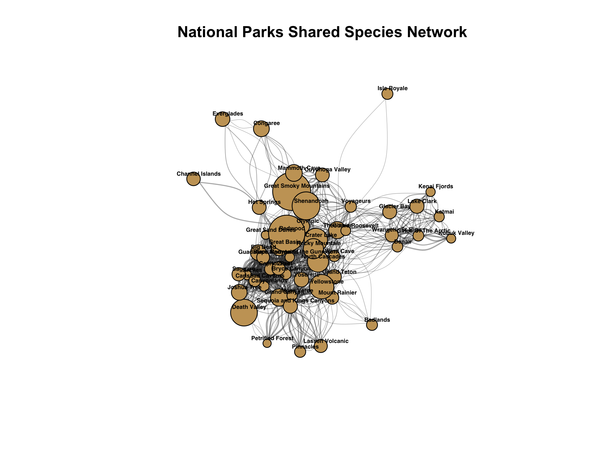

## Research Question
What follows is a visualizations showing which national parks share the most wildlife species?

# Network Definitions
**Nodes**: Each individual U.S. National Park extracted from my data set

**Edges**: Two parks are connected if they share one or more animal species.

**Edge weight**: The weight represents the exact number of shared mammal species between any connected pair of parks.

**Node size**: Total number of documented species.

## Data
Retreived data from: https://www.kaggle.com/datasets/nationalparkservice/park-biodiversity/data?select=species.csv
Uses the species.csv file

## My Social Network Visualization
{fig-align="center" width="70%"}

## Summary

The network visualization reveals clear ecological and geographic clustering driven by shared mammal species. Northern wilderness parks (such as Denali, Katmai, and Kobuk Valley) form a distinct, tightly connected northern tier at the top, while arid and desert southwestern parks (such as Death Valley, Joshua Tree, and Saguaro) cluster naturally at the bottom. Additionally, central and western temperate parks form a dense core with heavy interconnectivity, while unique island or isolated ecosystems like Channel Islands and Everglades sit on the outer edges away from the dense central core.
